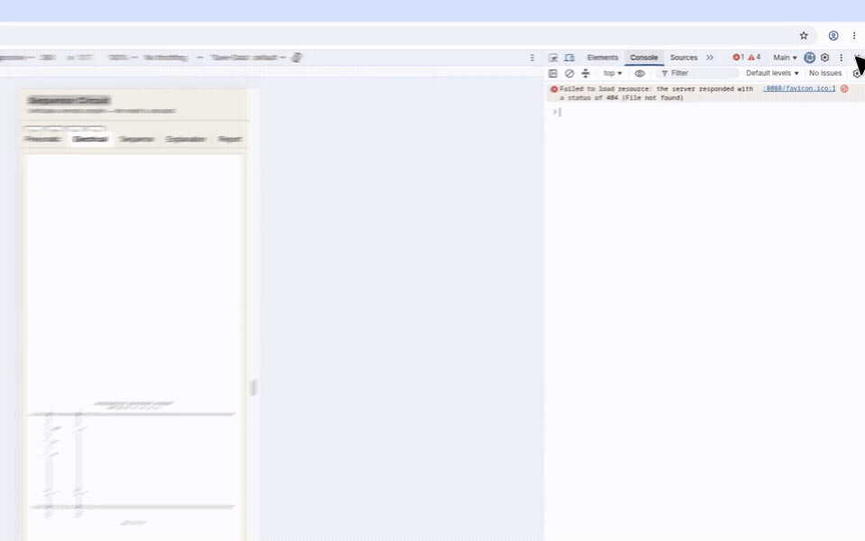

# Sequence Circuit

Verification-oriented compiler for AI-generated engineering systems.

The language model is **untrusted**. It may propose a YAML circuit spec. A deterministic compiler decides whether that spec is allowed to become a sheet. A pretty drawing that fails eval is not returned.

This is not an AI circuit generator. The compiler has authority over correctness.

## Demo

Workspace: Example A+ B+ → Generate. Sheets are emitted only if executed checks pass.

[](https://github.com/vaibhav11123/mcl431-circuits/releases/download/v0.1.0-distribution/sequence-circuit-workspace-demo.mp4)

**Video (21s, mp4):** [play / download](https://github.com/vaibhav11123/mcl431-circuits/releases/download/v0.1.0-distribution/sequence-circuit-workspace-demo.mp4) · [in-repo file](docs/release-assets/sequence-circuit-workspace-demo.mp4) (GitHub’s file viewer has the player)

## Three commands

```bash
pip install -e ".[dev]"
python -m circuit draw examples/iso_sequence/circuit.yaml
python -m circuit verify examples/iso_sequence/circuit.yaml
```

Workspace (editable sheets, download pack, sequence explorer): [`web/`](web/). Use from ChatGPT or Claude **or open the workspace**.

MCP (optional, local): `python -m circuit.mcp_server` (stdio) or `--http`.

SequenceBench:

```bash
python -m circuit bench benchmarks/sequencebench
python -m circuit bench --suite 300
python -m circuit bench --suite llm
```

The 300-case suite and the LLM fixtures call **no paid API**. Fly.io is not required ([docs/self-hosting.md](docs/self-hosting.md); T29 is SKIPPED_OPTIONAL, not deployed).

ChatGPT / Claude directory listing needs a human-operated public HTTPS origin. Local MCP does not make the plugin directory-eligible. See [plugin/SUBMISSION.md](plugin/SUBMISSION.md) and [HUMAN_ACTIONS_REQUIRED.md](HUMAN_ACTIONS_REQUIRED.md).

Release notes: [CHANGELOG.md](CHANGELOG.md). Launch copy: [docs/marketing.md](docs/marketing.md). Channel status: [docs/distribution.md](docs/distribution.md).

## Course goldens (MCL 431)

- **Sheets:** 2023 B1 grinding, 2017 hi-lo punch, 2023 Minor-2 strip feed, 2023 Minor-2 PLC conveyor, 2017 5/3 drill, 2016 emboss, L14 PLC set, 2018 air-jet (3Z = `dcv_3_2`), 2020 mill clamp (5 bar), 2022 two-hand stamp, 2023 four-hole drill, majors PLC (oven, sprinkler, lockout, preset counter, tank mix, orange juice, plywood stack, traffic / quiz conveyor)
- **Solution text** (figure given or numeric only): 2018 hi-lo, 2019 meter-in/out, 2016 hoist, 2023 B2 head loss, 2022 grind-given, 2019 vertical meter-out, 2020/2022 hoist with pipe loss, stepper/servo numbers, 2023 Part A, quiz regen
- **Not a sheet:** corporate-adaptation prose; CNC part programs until every figure coordinate is in `facts.yaml` (`not_given` otherwise)

Full gates: [docs/eval.md](docs/eval.md). Learnings log: [docs/pyq-solution-run-log.md](docs/pyq-solution-run-log.md).

## Related work

- FluidSIM — commercial simulator. We do not export `.ct`.
- FluidPyPLC (GPL) — **do not copy**. Cascade here is `meta.method: cascade` plus extra `dcv_5_2` valves.
- spec2schematic, Weave, CADPilot/CADX — model-written geometry. We are stricter: the model never writes geometry.
- Alive2 — independent src vs tgt check. Our analog is `spec_trace` vs `env_trace` (sensors from modeled actuators), not SMT, not CompCert.

## Three load-bearing decisions

1. Fail-closed `draw_yaml` and CLI `draw`: eval/verify fail → no sheet. `--unverified` watermarks.
2. Independent translation validation (T36), not a second call to the synthesizer.
3. Public ISO pack is vector + two Wikimedia CC-BY 5/2 and 5/3 rasters. Lecture PNG never ships in the public SVG.

Refused work: physics simulation, FluidSIM, OAuth, hosted LLM, lecture-PDF ingest on the public pack.

Eval failures are listed in `output/*/eval.json`. `circuit verify` writes `verify.json` with `physics: not_evaluated` for checks that were not run.
