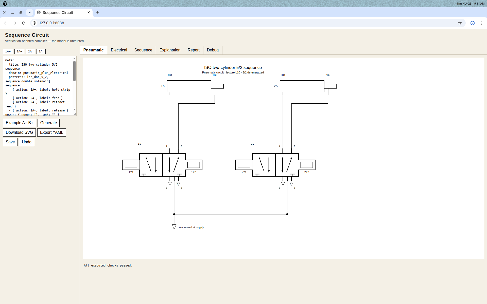
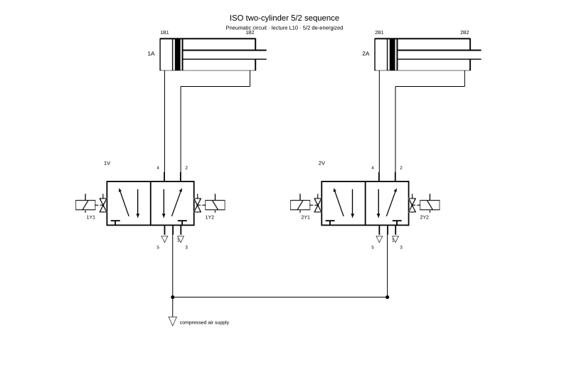
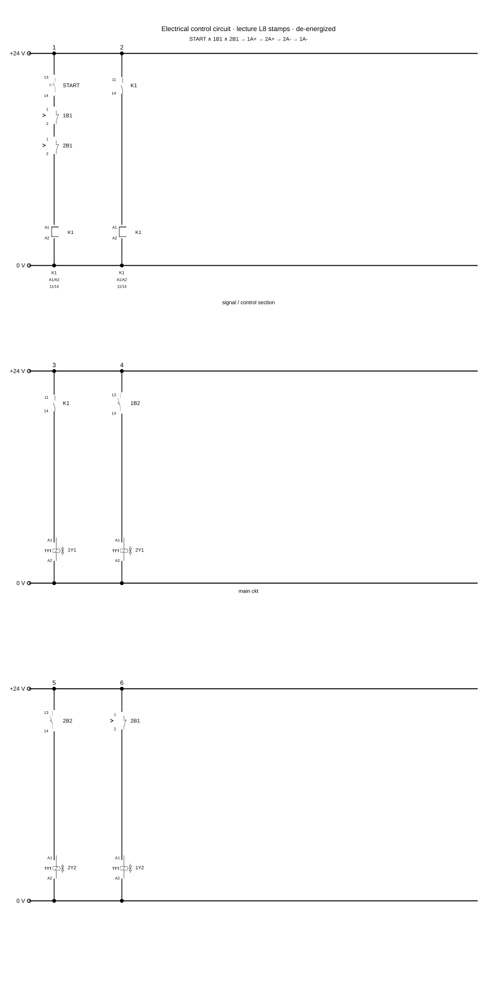

# Sequence Circuit

**Verification-oriented compiler for AI-generated engineering systems.**

A language model may propose YAML. The compiler decides whether it becomes a sheet.

[Open the workspace](https://vaibhav11123.github.io/mcl431-circuits/) · [v0.1 release](https://github.com/vaibhav11123/mcl431-circuits/releases/tag/v0.1.0-distribution) · [Changelog](CHANGELOG.md)

<p align="center">
  
</p>

<p align="center"><em>Example YAML → Generate → pneumatic / electrical / sequence. Status: all executed checks passed.</em></p>

<p align="center">
  
  &nbsp;
  
</p>

## Why this exists

Most “AI CAD” tools let the model draw. Sequence Circuit does the opposite:

1. You (or a model) write a **YAML** sequence.
2. The compiler **validates**, **draws**, and **verifies**.
3. Fail eval → **no sheet**. Fail-closed by default.

Not an AI circuit generator. The compiler has authority over correctness.

## Try it

**In the browser** (no install): [vaibhav11123.github.io/mcl431-circuits](https://vaibhav11123.github.io/mcl431-circuits/)

**On the CLI:**

```bash
pip install -e ".[dev]"
python -m circuit draw examples/iso_sequence/circuit.yaml
python -m circuit verify examples/iso_sequence/circuit.yaml
```

| Sheet | When |
| --- | --- |
| Pneumatic / hydraulic | Power circuit for the domain |
| Electrical | L8 paths when the paper asks |
| Sequence | Step–displacement diagram |
| Report | Executed checks in plain English |

Optional MCP: `python -m circuit.mcp_server` (stdio) or `--http`. Plugin zip: `python scripts/pack_plugin.py`.

## What it refuses

| Ask | What happens |
| --- | --- |
| Invented valve id | Refuse — pack symbols only |
| Pressure drop / FluidSIM `.ct` | Refuse |
| SVG that fails eval | No emit (or `--unverified` watermark) |
| Lecture-crop PNG in the public ISO pack | Never ships |

## Benchmarks (offline, no API key)

```bash
python -m circuit bench --suite 300   # 220 legal / 80 illegal
python -m circuit bench --suite llm   # fixtures only
```

## Packs

| Surface | Symbol pack |
| --- | --- |
| Public workspace / plugin | ISO sequence (vector + CC-BY 5/2·5/3) |
| Local MCL 431 course goldens | Lecture atlas — see [docs/eval.md](docs/eval.md) |

## Load-bearing decisions

1. **Fail-closed** draw: eval/verify fail → no sheet.
2. **Independent** `spec_trace` ⋈ `env_trace` — not a second synthesizer call, not CompCert.
3. Public SVG never embeds lecture PNGs.

## Docs

| Doc | Audience |
| --- | --- |
| [docs/architecture.md](docs/architecture.md) | How the compiler is wired |
| [docs/self-hosting.md](docs/self-hosting.md) | HTTPS MCP without Fly |
| [plugin/SUBMISSION.md](plugin/SUBMISSION.md) | ChatGPT / Claude directory paste |
| [docs/ops/](docs/ops/) | Release audit (maintainers) |

## License

MIT — [LICENSE](LICENSE).
